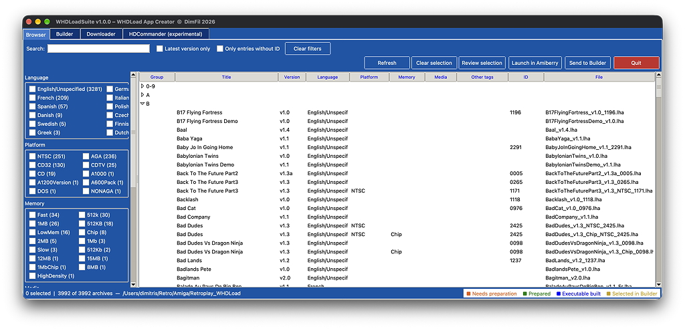
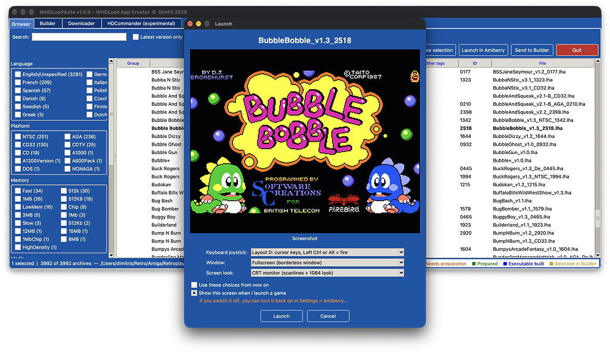
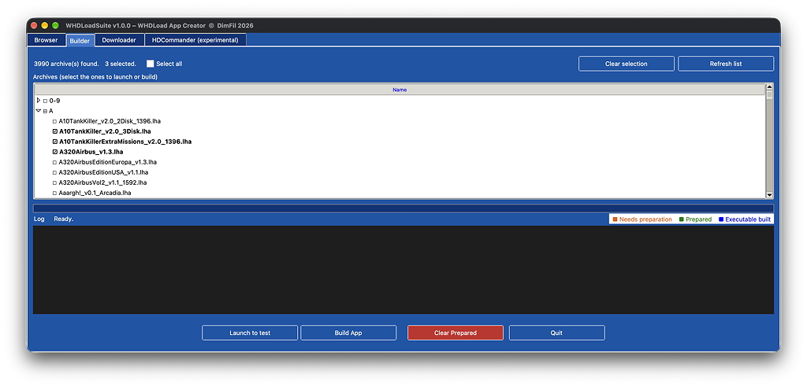
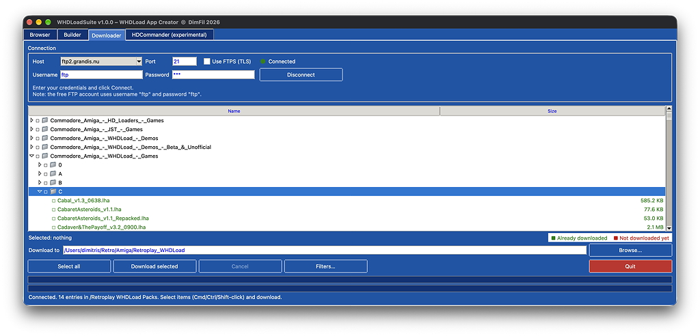
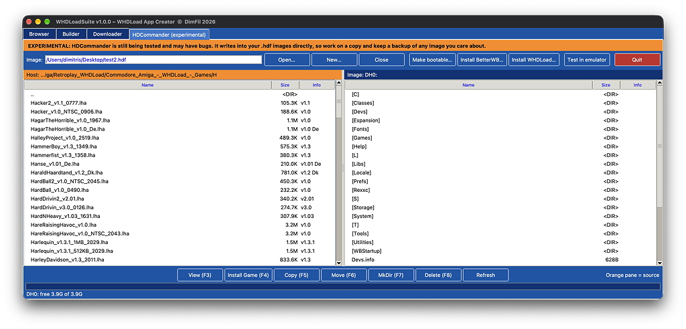
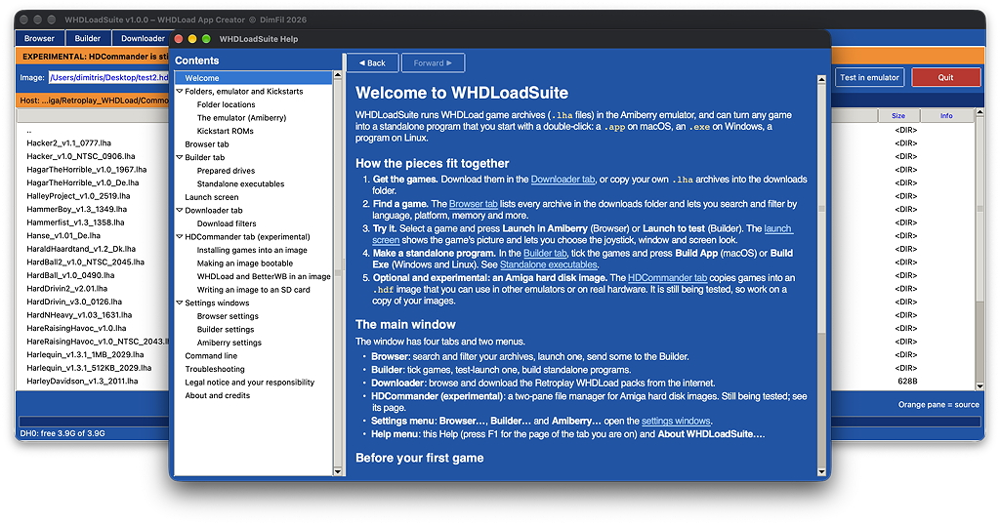
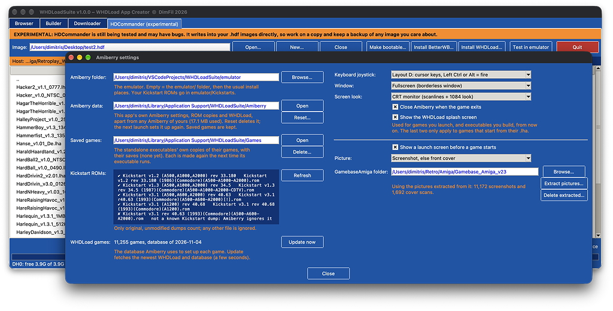

# WHDLoadSuite

Run WHDLoad `.lha` game archives in [Amiberry](https://github.com/BlitterStudio/amiberry), and optionally
turn each game into a standalone executable (a `.app` on macOS, `.exe` on Windows).

> **Legal notice.** WHDLoadSuite includes no games, Kickstart ROMs or emulator: you supply your own, and you are responsible for having the right to use and share them. The author is not responsible for any distribution of copyrighted games or ROMs by users, nor for illegally obtained material used with the app. See [Legal notice and responsibility](#legal-notice-and-responsibility).

## Screenshots

**Browser**: search and filter the archives, then launch one in Amiberry or send it to the Builder.

**Launch screen**: shown before a game starts, with its screenshot or cover and the keyboard, window and screen look choices for that launch.

**Builder**: tick games, test-launch them and build standalone programs.

**Downloader**: browse the Retroplay WHDLoad packs and download what you need.

**HDCommander (experimental)**: work inside Amiga hard disk images.

**Help**: a contents tree on the left and a page on the right, including folders, the emulator and Kickstart ROMs.

**Amiberry settings**: folders, keyboard, window and screen look, Kickstart ROM status and the launch screen.

## Requirements

- Python 3.10+ with tkinter (for the GUI). Developed and tested on macOS (Apple Silicon); the Windows and Linux paths are written but untested.
- Easiest start: double-click `start_macos.command`, `start_windows.bat` or `start_linux.sh`. It creates a `.venv`, installs the requirements and opens the GUI.
- `pip install -r requirements.txt`: PyInstaller (only for **Build App** on macOS or **Build Exe** on Windows/Linux), Pillow (the executables' icon and the launch screen's pictures) and amitools (HDCommander, experimental).
- Optional: `unar` (The Unarchiver's command line tools), only to extract the launch screen's pictures from the Gamebase source (see Launch screen).

## Work folder

Everything lives in a work folder (`work/` next to the scripts by default). The repository ships it with the template and empty
placeholder folders; you add the emulator, ROMs and games yourself (they are git-ignored):

| Path | Purpose |
|------|---------|
| `downloads/` | the WHDLoad `.lha` archives |
| `Template_WHDLoad/` | base Amiga drive copied for every prepared game (needs `C/WHDLoad`, `S/Startup-Sequence`, `Devs/Kickstarts`; the repository ships only `S/Startup-Sequence`, so copy the `WHDLoad` executable into `C/` yourself, for example from the WHDLoad download Amiberry makes); only the few games that run from a prepared drive use it |
| `Template_WHDLoad/Devs/Kickstarts/` | Kickstart ROMs for WHDLoad itself, named as described in the txt file there |
| `Icons/` | optional per-game icons for the standalone executables (`<game>.icns`/`.ico`/`.png`); every other game uses `images/icon.png` on all platforms (`default.*` here is only a last fallback) |

The emulator lives in a separate `emulator/` folder next to the scripts (git-ignored):

| Path | Purpose |
|------|---------|
| `emulator/Kickstarts/` | your Kickstart ROMs; they are copied into Amiberry's own folder (see below) |
| `emulator/Amiberry.app` (macOS) or an `amiberry` folder (Windows/Linux) | the emulator |

Generated output (one per archive, named after the archive without `.lha`, so every version is kept): `Whdload/<Game>/` (only for prepared games) and `Executables/`.

## Where Amiberry must be

**Playing** (**Launch to test**, `--launch`, and **Test in emulator** in the experimental HDCommander) uses [Amiberry](https://github.com/BlitterStudio/amiberry).
Put `Amiberry.app` (macOS) or the Amiberry folder (Windows/Linux) in `emulator/`, or choose it in **Settings > Amiberry…**. If neither is
set the app also looks in `/Applications/Amiberry.app`, `~/Applications/Amiberry.app` and on `PATH`. Put your Kickstart ROMs in
`emulator/Kickstarts` (1.3 and 3.1 A1200 are the usual ones; a game that needs another, for example 1.2, says so on screen).

A game runs straight from its `.lha`: Amiberry picks the model and memory from its WHDLoad database. The few games that cannot
(a slave that writes into its own folder, a game that hangs without a prepared drive) are listed in `common/amiberry_overrides.json`;
those run from their prepared drive, which is made automatically the first time. The same file can also give a game extra hardware (for example
16 MB of Zorro III RAM for Super Silly Skidmarks).

The app keeps its own Amiberry settings, ROMs and WHDLoad in `~/Library/Application Support/WHDLoadSuite/Amiberry` (Windows:
`%APPDATA%\WHDLoadSuite`, Linux: `~/.local/share/WHDLoadSuite`), separate from your own Amiberry. The same folder also holds `Games` (saves of standalone executables) and `Gamebase` (pictures extracted for the launch screen). On macOS and Linux even its small settings file (window positions and its list of ROMs) is kept in the `Settings` folder inside it, so your own Amiberry is never read or changed; on Windows that part is not handled yet. The first launch copies your
ROMs there and downloads WHDLoad (from whdload.de and Aminet, a few seconds).

Several games can run at the same time (from the app and from built executables). Games started from their `.lha` share one boot folder inside that data folder, so if you use Amiberry's reset on the first game after starting another, the first game restarts as the newer one; just close and launch it again.

**Settings > Amiberry…** is where Amiberry is set up:

- **Amiberry folder** (where Amiberry is) and, right under it, **Amiberry data**, which shows the app's own Amiberry folder (see above) with its size and two buttons: **Open** shows it in Finder/Explorer, and
  **Reset…** deletes it after a confirmation (it is set up again by the next launch, which copies your ROMs and downloads WHDLoad
  again; your files in `emulator/Kickstarts` are never touched). Saved games of standalone executables live in the `Games` folder
  next to it, which Reset keeps. Reset is refused while a game started from this app is still open.
- **Saved games** shows the `Games` folder (see above) with how many games it holds and its size. **Open** shows it in Finder/Explorer, and **Delete…** deletes it after a confirmation: that erases the saves and high scores of your standalone executables, and each executable makes a new copy the next time it runs. **Clear Prepared** in the Builder never touches it, and Reset does not either. Deleting is refused while a game started from this app is still open (close any running standalone executable yourself first).
- **Keyboard joystick**: which keyboard layout drives the joystick on port 1 (A numeric keypad, B/D cursor keys with Right/Left Ctrl or Alt as
  fire, C W A S D), or none. The default is D.
- **Window** (windowed or a borderless full-screen window) and **Screen look** (normal, scanlines, or a CRT monitor look with Amiberry's 1084 shader).
- **Close Amiberry when the game exits** and **Show the WHDLoad splash screen** (the short information screen WHDLoad shows before a game). These two
  only apply to games that start from their `.lha`.
- These choices are used for every game you launch from now on and are built into the executables you build from now on (an executable's launch screen can change them again).
- **Launch screen** and **Picture**, and the **GamebaseAmiga folder** with its **Extract pictures…** and **Delete extracted…** buttons: see *Launch screen* below.
- **Kickstart ROMs**: which of your ROMs Amiberry recognised, which files it ignores (it only accepts original dumps) and whether an A500/A600 3.1
  ROM is missing. **Refresh** reads it again; it is filled in after the first launch.
- **WHDLoad games**: the size and date of the game database Amiberry uses to set up each game, and **Update now** to fetch the newest WHDLoad and
  database from whdload.de and Aminet.

**Building executables** (**Build App/Exe**, `--bundle`) copies Amiberry into each executable, so it must be a complete, self-contained
copy: on macOS the whole `Amiberry.app` (from `emulator/`, `/Applications` or `~/Applications`), on Windows/Linux the folder holding the
binary together with its data and libraries. A bare binary on `PATH` (for example a Homebrew install) cannot be bundled. An executable
holds the game's `.lha`, Amiberry, WHDLoad and your Kickstart ROMs (about 60 MB, and 3 MB more for the launch screen), keeps its saves under the per-user `WHDLoadSuite` folder
described above, and only runs on the OS it was built on. Games that need their prepared drive (see `common/amiberry_overrides.json`)
are prepared automatically as part of the build; any other game is built straight from its archive.

## GUI

    python gui.py

The window has four tabs that share one **downloads folder** (where the `.lha` archives live): find archives with the
Browser, turn them into games with the Builder, download more with the Downloader, and install them into an Amiga hard
disk image with HDCommander (experimental). The **Settings** menu holds all folder choices, in a window for each part of the app:
**Browser…** (the downloads folder), **Builder…** (the work folder, the prepared-games folder and the executables
folder) and **Amiberry…** (where Amiberry is, its data folder, how a game starts and the launch screen's pictures), each with a short note on what it is. The Amiberry window has two columns: Amiberry, its data, the Kickstart ROMs and the game database on the left, the launch choices and the launch screen on the right. The Downloader
saves into the downloads folder, so changing one changes the other. The **Help** menu opens the Help window (F1 opens it at the page of the tab you are on), and the version info. The Help has a page for every tab, button and setting, and for folders, the emulator and Kickstart ROMs; its pages are the Markdown files in `help/`, listed in `help/contents.json`.

### Browser

Search and filter the `.lha` archives in the downloads folder. Each file name (`Game_v1.2_AGA_De_2MB_Disk2_1234.lha`) is
parsed into title, version, language, platform, memory, media, other tags and ID.

- **Search** matches the title or file name as you type.
- The left panel has check lists for **Language**, **Platform**, **Memory**, **Media** and **Other tags** (tags seen at least twice), each with a count. Ticking several values in one list shows archives matching any of them; different lists combine, so all must match.
- **Latest version only** keeps just the newest version of each game variant.
- **Only entries without ID** shows archives whose name has no ID.
- **Clear filters** resets the search and all filters.
- Click a column heading to sort, click again to reverse. Double-click a row to reveal the file in Finder/Explorer.
- Archives are grouped by the first character of the title (0-9, A-Z); the groups start collapsed (they open automatically while searching or reviewing the selection).
- **Selecting**: a click selects only that row (click it again to unselect it), **Cmd+click** (Ctrl+click on Windows and Linux) adds or removes a single row, and **Shift+click** selects the range from the last clicked row. Selected rows are shown in bold.
- **Review selection** lists only the selected rows (the filters are ignored while it is on). **Send to Builder** ticks those archives on the Builder tab; with nothing selected it sends all listed archives, after a confirmation warning. Only `.lha` files can be launched or built.
- **Launch in Amiberry** (top bar, next to **Send to Builder**) runs the one selected game (click its row) in Amiberry, like **Launch to test** in the Builder. The launch screen (see below) comes first, and tells you when the game needs a prepared drive, which is made before it starts.
- Row colours (the same as in the Builder): **orange** = the game needs a prepared drive and has none yet, **green** = it has one, **blue** = a standalone executable was built, **gold** = ticked in the Builder. Games with no colour run straight from their `.lha` and need nothing.
- **Refresh** rescans the downloads folder (this also happens when you open the tab).

### Builder

Test and build the games found in the downloads folder.

- The folders are chosen in the **Settings** menu and remembered between runs: **Builder…** (work, prepared games and executables folders).
- Tick the archives to use (**Select all** ticks everything). **Launch to test** and **Build App/Exe** only work on ticked archives; with nothing ticked they show a message asking you to select items first.
- **Launch to test** runs the game in Amiberry, straight from its `.lha`, after the launch screen (see below). The first launch downloads WHDLoad.
- **Build App** (macOS) / **Build Exe** (Windows/Linux) builds a standalone executable of each ticked game in `Executables/`, using Amiberry (see above), with a progress bar and log.
- The few games listed in `common/amiberry_overrides.json` run from a prepared drive instead (`Whdload/<Game>/`, made from `Template_WHDLoad`). Launch and Build make it automatically the first time; nothing has to be done by hand. **Launch to test** (and the Browser's **Launch in Amiberry**) tells you first, on the launch screen, and lets you cancel; **Build App** prepares as part of the build and says so in the log. Colours: a game that needs a drive is **orange** until it has one, then **green**; a built executable is **blue**; every other game has no colour, because it needs nothing.
- **Clear Prepared** deletes the prepared drives in `Whdload` (for example after changing `Template_WHDLoad`); they are made again when needed.
- **Refresh list** rescans the downloads folder.

### Launch screen

The window shown when you launch a game from the Browser or the Builder (**Launch in Amiberry**, **Launch to test**).

- It shows the game's screenshot (or its front cover), enlarged by a whole number so the pixels stay sharp, and three choices for this launch: **Keyboard joystick**, **Window** and **Screen look**. They start from your choices in Settings > Amiberry… and change only this launch.
- Tick **Use these choices from now on** to keep them as your defaults. Untick **Show this screen when I launch a game** to skip the screen from now on; the same switch is **Show a launch screen before a game starts** in Settings > Amiberry…, which is also where to turn it back on.
- **Launch** (or Return) starts the game, **Cancel** (or Esc) does not. A game that needs a prepared drive is said so on the screen; the drive is made when you press Launch.
- Without a picture for the game, or with no pictures set up, the screen still appears with a note instead of the picture.
- **Standalone executables** have the launch screen too, when **Show a launch screen before a game starts** is on while you build them (**Build App/Exe** and `--bundle`). The game's picture is saved inside the executable as a small PNG (so it needs no GamebaseAmiga folder afterwards), and Tk is bundled with it (about 3 MB). The executable starts from the choices it was built with; **Use these choices from now on** and **Show this screen when I launch a game** are kept for that one executable, in the per-user `WHDLoadSuite/Launch` folder (delete `Launch/<game>.json` there to get the screen back). Without a display or Tk the game just starts.
- **Picture** (Settings > Amiberry…) chooses the screenshot, the front cover, or the screenshot with the cover as a fallback.
- **GamebaseAmiga folder** (Settings > Amiberry…) is where the pictures come from, and it is only read. Choose the `data` folder of GamebaseAmiga (the one with `screenshots` and `extras`) or the GamebaseAmiga folder that holds it.
- Or choose the original Gamebase_Amiga_v2.3 source folder (the one with `Screenshots.rar` and `Extras.rar`) and press **Extract pictures…**. The screenshots and the front covers (about 330 MB, a few seconds) are unpacked into the app's own data folder, `Gamebase` next to `Amiberry`, and used from there; the rest of the 6 GB `Extras.rar` is skipped. Pressing it again replaces the earlier pictures. **Delete extracted…** removes them again after asking (only that folder, never your source) to get the space back.
- Extracting needs `unar` and `lsar` from The Unarchiver's command line tools: `brew install unar` on macOS, `sudo apt install unar` on Linux. On Windows download them from theunarchiver.com/command-line and unzip them into a `tools` folder next to the app, or add them to the PATH.
- Games are matched to pictures by name with `common/gamebase_images.json`: about 3,300 of the 3,990 Retroplay archives have one, and a game that is not in the file is looked for by name among the picture files. For other archives make the file again with `python tools/make_gamebase_map.py --gamebase <GamebaseAmiga project> --downloads <archives folder>`.

### Downloader

Browse and download the `/Retroplay WHDLoad Packs` folder on the grandis.nu FTP server into the downloads folder.

- **Connect** with the pre-filled free account (`ftp` / `ftp`); optional FTPS (TLS).
- Open folders with the arrow to browse them (loaded lazily). Click a row or press Space to tick it; ticking a folder ticks everything inside it.
- The total size of the selection is shown live; folder sizes are measured in the background.
- Files already in the downloads folder show in green, missing ones in red.
- **Filters…** limits what is downloaded from the ticked folders by search, language, platform, memory, media, other tags, latest version or entries without ID, with a live count and size of the files kept. Only matching files are fetched; files you tick yourself are always downloaded.
- **Download selected** mirrors the server layout under the downloads folder, skips files that already exist with the same size, and shows per-file and overall progress. **Cancel** stops and removes the partly downloaded file.

### HDCommander (experimental)

**HDCommander is still experimental.** The tab says so (an orange *EXPERIMENTAL* bar, and its name in the tab bar). It writes into your `.hdf` images directly, so work on a copy and keep a backup of any image you care about. Nothing else in the app depends on it.

A dual-pane file manager (Norton Commander style) for Amiga hard disk images (`.hdf`): host files on the left, the
image on the right. Needs `amitools` (see `requirements.txt`); images use OFS/FFS, so keep them under about 4 GB.

- **Open…** an existing `.hdf` or **New…** to create one (size in MB). The last image is remembered. A new image is
  empty: it needs Workbench and a Kickstart to boot, which you supply yourself.
- The left pane starts in the downloads folder. Double-click or Enter opens a folder (or `..`), Backspace goes up.
- Click a file list or its title bar (**Host** / **Image**) to make it the active pane (orange bar). Select one or more
  rows, then **Copy (F5)** or **Move (F6)** from the active pane to the other one. These copy files exactly as they are (folders recursively), `.lha` archives included.
- **Install Game (F4)** takes the selected `.lha` archives (or folders of them) in the host pane and installs each
  WHDLoad game under `Games/<A-Z|0-9|#>/<Game>/` on the image. Games already there are skipped, and archives without a
  WHDLoad slave are reported as skipped. Other files in a selected folder are ignored.
- **View (F3)** shows a text file (or a hex dump), **MkDir (F7)** creates a folder, **Delete (F8)** deletes after a
  confirmation (host files are deleted permanently).
- Amiga rules apply inside the image: names up to 30 characters, case-insensitive, Latin-1 characters only.
  Items that cannot be copied are listed in a report instead of stopping the whole job.
- **Make bootable…** installs Amiga Workbench 3.1 into the image from your original floppy disks, so that it boots.
  Pick the folder that holds the disks as `.adf` (or `.adz`) files; they are recognised by their disk names:
  `Workbench3.1` and `Install3.1` are required, `Extras3.1`, `Locale`, `Fonts` and `Storage3.1` are optional. It repeats
  the steps of the official Install3.1 Installer script (Workbench to the root, Extras merged in, Locale, Fonts and
  Storage into their drawers, the hard-disk `Startup-Sequence`) and activates the PAL or NTSC monitor driver. An
  existing startup script is kept as `S/Startup-Sequence.old`. Workbench is copyrighted: you must supply the disks.
  **Test image** boots the image in Amiberry as an Amiga 1200 with a Kickstart 3.1 ROM.
- **Install WHDLoad…** installs the official WHDLoad distribution (`WHDLoad_usr….lha`, from the WHDLoad web site or
  Aminet) into the image: the programs in `C/` go to `C:` (a newer version already there is kept), the three files in
  `S/` go to `S:` (a different existing file is kept and the new one saved as `<name>.default`), and optionally the
  documentation goes to `Help/WHDLoad`. It also creates `Devs/Kickstarts` and tells you which Kickstart ROM images
  (and matching `.RTB` files) games with Kickstart emulation need there: `kick33180.A500` (1.2), `kick34005.A500`
  (1.3), `kick40063.A600`, `kick40068.A1200` and `kick40068.A4000` (3.1). The ROMs are copyrighted and not part of
  WHDLoad. If your work folder's `Template_WHDLoad/Devs/Kickstarts` already contains Kickstart files, you are asked
  whether to copy them into the image (files already there are kept); otherwise, or if you say No, copy your own into
  `Devs/Kickstarts` with the file manager.
- The keys F3-F8 work when a file list has focus; the buttons at the bottom do the same.

## Command line

    python builder.py [games ...] [--work-dir DIR] [--force]   # prepare drives by hand (normally automatic)
    python builder.py GAME --launch [--amiberry-dir DIR]       # run in Amiberry
    python builder.py GAME [GAME ...] --bundle                 # build executables

Kickstart ROMs and game archives are copyrighted; you must supply your own and you are responsible for your use of them (see the Legal notice below).

## Project layout

The window is built by `gui.py`; every tab has its own folder under `tabs/`, and what several tabs share is in
`common/`.

| Path | Purpose |
|---|---|
| `gui.py` | The main window: builds the tabs, the menu and the Workbench-blue styles, and connects the tabs |
| `builder.py` | Command line for the Builder tab (see below) |
| `help/` | The pages of the Help window (Markdown) and `contents.json`, the tree on its left; `common/help_dialog.py` is the window |
| `tabs/builder/` | **Builder** tab: `tab.py` is the window, `core.py` prepares and launches games (also behind the command line), `launcher.py` starts a game in Amiberry for the Builder and Browser tabs, `launch_screen.py` is the window shown before it starts (the picture from Pillow; the window itself is `common/launch_window.py`), `bundle.py` builds the standalone executables |
| `tabs/downloader/` | **Downloader** tab: FTP browser and downloader, with its own README |
| `tabs/browser/` | **Browser** tab: search and filter the archives, and launch a game |
| `tabs/settings/` | The **Settings** menu: `settings.py` keeps the folder choices the tabs share, `window.py` is the three settings windows (Browser, Builder, Amiberry) |
| `tabs/hdcommander/` | **HDCommander** tab (experimental): `tab.py` is the window; `volume.py` reads and writes the `.hdf`, `adf.py` reads floppy disk images, `workbench.py` makes an image bootable, `installer.py` installs games, `whdinstall.py` installs WHDLoad itself, `transfer.py` copies files, `browse.py` lists the two panes |
| `common/` | Shared code: `lha.py` (LHA reader), `whdparse.py` (archive names), `gamepaths.py` (game names and where generated files go), `paths.py`, `settings.py`, `theme.py`, `dialogs.py` (Amiga-style windows), `about_dialog.py`, `help_dialog.py`, `utils.py`, `amiberry.py` (finding, setting up and starting Amiberry), `amiberry_runtime.py` (its command lines and per-game overrides, also run inside every executable), `launch_window.py` (the launch screen window, shared with the executables), `gamebase.py` (finds, and extracts, the launch screen's pictures) and `gamebase_images.json` (which picture belongs to which game) and `amiberry_overrides.json` (the games that need something other than the default) |
| `tools/` | `make_gamebase_map.py` makes `common/gamebase_images.json` (see the launch screen above) |
| `tests/` | Mirrors the layout: `tests/<tab>/` and `tests/common/`. Run with `python -m unittest discover -s tests -t .` |

## Legal notice and responsibility

WHDLoadSuite is a tool. It does **not** include, and its author does not provide, host or distribute, any **game**, any **Kickstart ROM**, Workbench disk or other Amiga system software, or **Amiberry** or **WHDLoad** (which have their own authors and licences). You supply them yourself.

- **You are responsible** for having the legal right, in your country, to every game, ROM, disk image and other file you use with the app. Games and Kickstart ROMs are copyrighted.
- The author is **not responsible** for what you download, copy, install, run or distribute with the app, or for where it comes from. The author has **no responsibility** if you use illegally obtained material, or material you have no right to use, with the app. You use the app, and any such material, entirely at your own risk.
- **Standalone executables** contain a copy of the game, your Kickstart ROMs, Amiberry and WHDLoad. **Giving, sharing, uploading, selling or otherwise distributing them is redistribution of copyrighted material, and that is solely the user's responsibility.** Kickstart ROMs may not be passed on without permission from their owners. If in doubt, keep what you build for your own use.
- The **Downloader** connects to a server run by someone else, whose contents the author does not control. The **launch screen's pictures** come from the GamebaseAmiga collection and belong to their owners.
- The software is provided **as is**, without warranty (see the MIT licence below). This notice is not legal advice, and laws differ from country to country.

The same notice is in the app's Help window (**Legal notice and your responsibility**).

## License

MIT, see [LICENSE](LICENSE). Applies to the code only, not to Amiberry, WHDLoad, Kickstart ROMs or games.
